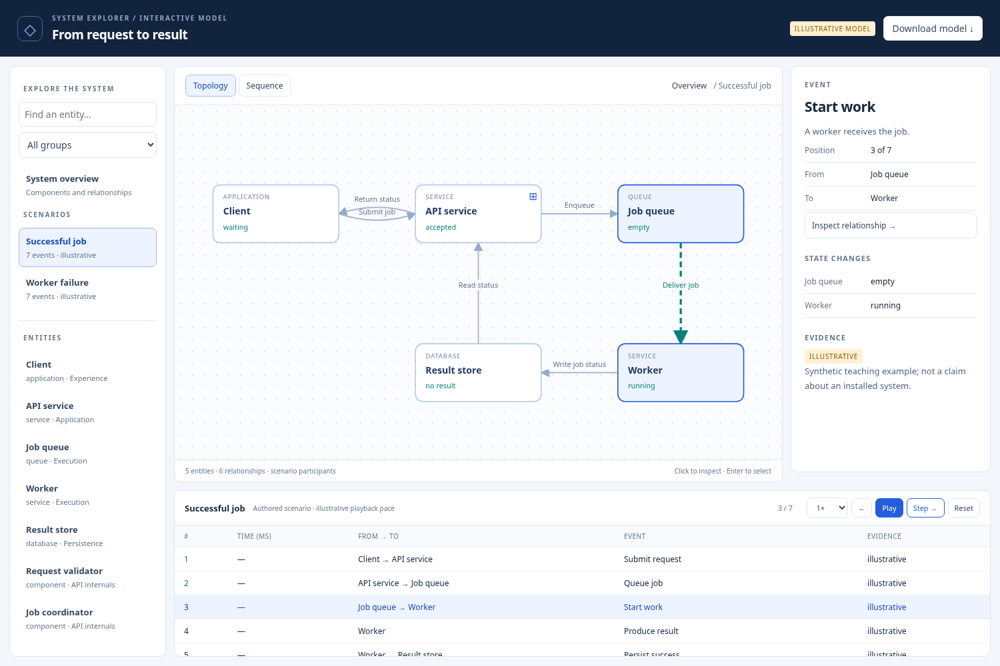

# turbo_oxi

My personal collection of reusable AI agent skills. Each skill packages a
repeatable workflow with the instructions, scripts, templates, and examples
needed to use it across projects.

## Skills

| Skill | What it does |
| --- | --- |
| [System Explorer](skills/system-explorer) | Turns architecture, processes, workflows, protocols, and data flows into interactive explorers with clickable components, scenario playback, and inspectable evidence. |

## Get started

```sh
git clone https://github.com/theOxifier/turbo_oxi.git
```

Choose a skill from `skills/` and follow its README. To use it with an agent,
install the complete skill folder in the skill location supported by that
agent. Each folder includes a `SKILL.md` entry point; retain its bundled files.

For example:

> Use system-explorer to visualize this system. Show its components and
> handoffs, let me inspect what moves between them, and distinguish supported
> facts from assumptions.

## First skill: System Explorer

The workflow is **frame a question → gather evidence → model entities and
relationships → author scenarios → validate → render → inspect → refine**.

The same viewer works for a software architecture or a human process. It
provides topology and sequence views, nested exploration, a detail inspector,
step controls, state changes, and visible evidence. Generated explorers are
self-contained HTML files with an editable JSON model.



Generate the two bundled examples:

```sh
cd turbo_oxi/skills/system-explorer
python3 scripts/render.py examples/software-system.json --output out/software-system.html
python3 scripts/render.py examples/approval-process.json --output out/approval-process.html
```

Open either HTML file in a browser. See the [skill README](skills/system-explorer/README.md)
for the model format, controls, and validation commands.

## Add another skill

Create `skills/<skill-name>/` with:

- `SKILL.md`: when to use the skill and how to execute its workflow.
- `README.md`: setup, usage, examples, and any requirements.
- Scripts, templates, references, and examples needed to make it repeatable.
- Appropriate checks when the skill includes executable code.

Keep examples synthetic and avoid committing credentials, private inputs, or
generated project-specific output. Skills should be portable across projects.
